---

## 👋 Sobre mim

Sou estudante de **Sistemas de Informação (4º período)** e apaixonado por criar interfaces onde **design e código se encontram**. Meu foco é o **front-end**: transformar layouts em sites responsivos, limpos e agradáveis de usar.

- 🐍 **Python é a linguagem que mais uso**, e levo essa lógica para o desenvolvimento web
- 🎨 Cuido do visual: tipografia, espaçamento, cores e hierarquia
- 📱 Construo sites responsivos, pensando primeiro no mobile
- ♿ Me preocupo com acessibilidade e experiência do usuário
- 🌱 Estudando para evoluir rápido e aprender com times reais
- 🎯 **Buscando estágio em desenvolvimento front-end / UI**

---

## 🛠️ Tecnologias

<!-- Adicione só o que você realmente usa. Exemplos: -->
<!--  -->
<!--  -->
<!--  -->

---

## 🚀 Projetos em destaque

| Projeto | Descrição | Tecnologias | Links |
|---|---|---|---|
| **[Nome do projeto 1]** | Uma frase sobre o que ele faz e o problema que resolve | HTML • CSS • JS | [Demo](#) · [Código](#) |
| **[Nome do projeto 2]** | Ex.: Landing page responsiva para uma cafeteria fictícia | HTML • CSS | [Demo](#) · [Código](#) |
| **[Nome do projeto 3]** | Ex.: Portfólio pessoal com tema claro/escuro | HTML • CSS • JS | [Demo](#) · [Código](#) |

> 💡 Fixe (pin) no perfil os 3 a 6 melhores repositórios, cada um com README, prints e link do site no ar.

---

## 📊 Estatísticas

---

## 📚 Estudando agora

- ⚛️ React e componentização
- 🧩 Design systems e boas práticas de UI/UX
- 🔷 TypeScript
- 🗄️ Fundamentos de banco de dados e back-end (pelo curso)

---

## 🤝 Vamos conversar?

Estou aberto a oportunidades de **estágio** e adoro trocar ideias sobre design e desenvolvimento web.

